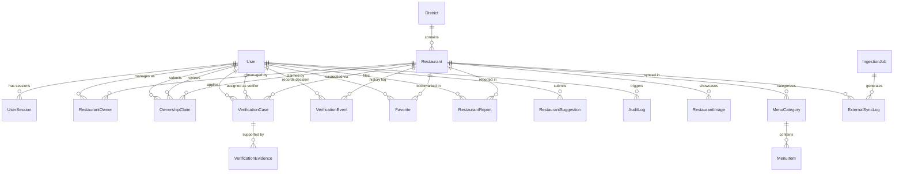

# Halal Dine — Architectural Database Reference

> [!NOTE]
> This document serves as the **architectural reference design** for Halal Dine's data models. Database tables and Prisma models are created **incrementally** as each individual feature module is built, rather than all upfront.

---

## 1. Domain Architecture & Principles

1. **Unified Identity:** A single `User` model supports Customer, Restaurant Owner, and Admin/Verifier roles with session management and MFA support.
2. **PostGIS Geolocation:** Geospatial coordinates are indexed via PostGIS `geometry(Point, 4326)` using GIST indexing for sub-millisecond proximity queries (`ST_DWithin`, `ST_Distance`).
3. **Decoupled Ownership vs. Halal Status:** Business ownership claims (`OwnershipClaim` $\rightarrow$ `RestaurantOwner`) grant profile/menu management only and never alter halal verification status.
4. **Immutable Verification Audit:** All halal verification decisions, validity windows, and certificate evidence are permanently recorded in `VerificationEvent`.
5. **External Sync Protection:** Scrapers (Apify / Google Places) update external ratings and review counts, but `isProtectedFromSync` prevents overwriting verified data or owner edits.

---

## 2. Visual Entity-Relationship (ER) Diagram



---

## 3. Reference Prisma Schema

```prisma
// ==============================================================================
// Halal Dine — Architectural Reference Schema
// Engine: PostgreSQL 16 + PostGIS 3.4
// ORM: Prisma 6.19.3
// ==============================================================================

generator client {
  provider = "prisma-client-js"
}

datasource db {
  provider = "postgresql"
  url      = env("DATABASE_URL")
}

// ------------------------------------------------------------------------------
// ENUMS
// ------------------------------------------------------------------------------

enum UserRole {
  CUSTOMER
  RESTAURANT_OWNER
  VERIFIER
  ADMIN
}

enum UserStatus {
  ACTIVE
  SUSPENDED
  DEACTIVATED
}

enum OwnerRole {
  PRIMARY_OWNER
  MANAGER
}

enum HalalVerificationStatus {
  UNVERIFIED
  RESTAURANT_CLAIMS_HALAL
  VERIFICATION_PENDING
  VERIFIED_HALAL
  VERIFICATION_EXPIRED
  REPORT_UNDER_REVIEW
}

enum ClaimStatus {
  PENDING
  UNDER_REVIEW
  APPROVED
  REJECTED
  MORE_INFO_NEEDED
}

enum BusinessRegistrationType {
  FSSAI
  GSTIN
  TRADE_LICENSE
  UDYAM
  OTHER
}

enum VerificationCaseStatus {
  SUBMITTED
  UNDER_REVIEW
  APPROVED
  REJECTED
  EXPIRED
  REVOKED
  SUSPENDED
}

enum EvidenceDocumentType {
  HALAL_CERTIFICATE
  SUPPLIER_HALAL_CERTIFICATE
  SUPPLIER_INVOICE
  FSSAI_LICENSE
  AFFIDAVIT
  ON_SITE_AUDIT_REPORT
  KITCHEN_PHOTO
}

enum ReportType {
  INCORRECT_HALAL_STATUS
  EXPIRED_CERTIFICATE
  PORK_OR_ALCOHOL_SERVED
  CLOSED_PERMANENTLY
  INCORRECT_LOCATION_OR_PHONE
  OTHER
}

enum ReportStatus {
  PENDING
  INVESTIGATING
  VERIFIED_STATUS_CHANGED
  DISMISSED
}

enum SuggestionStatus {
  PENDING
  APPROVED_ADDED
  REJECTED
  DUPLICATE
}

enum PriceRange {
  BUDGET       // Under ₹250 for two
  MODERATE     // ₹250 - ₹600 for two
  EXPENSIVE    // ₹600 - ₹1200 for two
  FINE_DINING  // ₹1200+ for two
}

enum DietaryTag {
  NON_VEG
  VEG
  EGG
  VEGAN
}

enum ImageType {
  COVER
  GALLERY
  MENU
  FACILITY
  KITCHEN
}

enum DataSource {
  MANUAL_ENTRY
  GOOGLE_PLACES
  APIFY_SCRAPER
  USER_SUGGESTION
}

enum IngestionStatus {
  PENDING
  RUNNING
  COMPLETED
  FAILED
}

// ------------------------------------------------------------------------------
// 1. IDENTITY & AUTHENTICATION
// ------------------------------------------------------------------------------

model User {
  id              String     @id @default(uuid())
  email           String     @unique
  phone           String?    @unique
  name            String
  passwordHash    String
  role            UserRole   @default(CUSTOMER)
  status          UserStatus @default(ACTIVE)
  isEmailVerified Boolean    @default(false)
  isPhoneVerified Boolean    @default(false)
  avatarUrl       String?
  mfaEnabled      Boolean    @default(false)
  mfaSecret       String?
  lastLoginAt     DateTime?
  createdAt       DateTime   @default(now())
  updatedAt       DateTime   @updatedAt

  sessions               UserSession[]
  restaurantOwners       RestaurantOwner[]
  submittedClaims        OwnershipClaim[]        @relation("ClaimantUser")
  reviewedClaims         OwnershipClaim[]        @relation("ClaimReviewerUser")
  verificationCases      VerificationCase[]      @relation("ApplicantUser")
  assignedVerifications  VerificationCase[]      @relation("AssignedVerifier")
  verificationEvents     VerificationEvent[]     @relation("DecisionActor")
  favorites              Favorite[]
  submittedReports       RestaurantReport[]      @relation("ReporterUser")
  resolvedReports        RestaurantReport[]      @relation("ReportResolverUser")
  suggestedRestaurants   RestaurantSuggestion[]  @relation("SuggestedByUser")
  reviewedSuggestions    RestaurantSuggestion[]  @relation("SuggestionReviewerUser")
  auditLogs              AuditLog[]

  @@index([role])
  @@index([status])
  @@index([email])
}

model UserSession {
  id         String    @id @default(uuid())
  userId     String
  tokenHash  String    @unique
  deviceInfo String?
  ipAddress  String?
  userAgent  String?
  expiresAt  DateTime
  revokedAt  DateTime?
  createdAt  DateTime  @default(now())
  updatedAt  DateTime  @updatedAt

  user User @relation(fields: [userId], references: [id], onDelete: Cascade)

  @@index([userId])
  @@index([expiresAt])
}

// ------------------------------------------------------------------------------
// 2. GEOGRAPHIC REFERENCE (KERALA DISTRICT ROLLOUT)
// ------------------------------------------------------------------------------

model District {
  id           String   @id @default(uuid())
  name         String   @unique
  slug         String   @unique
  state        String   @default("Kerala")
  country      String   @default("India")
  latitude     Float
  longitude    Float
  isActive     Boolean  @default(true)
  displayOrder Int      @default(0)
  createdAt    DateTime @default(now())
  updatedAt    DateTime @updatedAt

  restaurants Restaurant[]

  @@index([isActive])
  @@index([slug])
}

// ------------------------------------------------------------------------------
// 3. RESTAURANT DIRECTORY & SPATIAL ENGINE
// ------------------------------------------------------------------------------

model Restaurant {
  id                  String                  @id @default(uuid())
  slug                String                  @unique
  name                String
  brandName           String?
  description         String?
  address             String
  city                String
  districtId          String
  state               String                  @default("Kerala")
  postalCode          String?
  country             String                  @default("India")
  phone               String?
  email               String?
  website             String?
  latitude            Float
  longitude           Float
  openingHours        Json?
  priceRange          PriceRange              @default(MODERATE)
  cuisines            String[]
  features            String[]
  coverImageUrl       String?
  logoUrl             String?

  halalStatus         HalalVerificationStatus @default(UNVERIFIED)
  halalSummary        String?
  halalVerifiedAt     DateTime?
  halalExpiresAt      DateTime?

  isClaimed           Boolean                 @default(false)
  isActive            Boolean                 @default(true)
  isProtectedFromSync Boolean                 @default(false)
  dataSource          DataSource              @default(MANUAL_ENTRY)
  googlePlaceId       String?                 @unique
  googleRating        Float?
  googleReviewCount   Int?
  googleMapsUrl       String?

  createdAt           DateTime                @default(now())
  updatedAt           DateTime                @updatedAt

  district            District                @relation(fields: [districtId], references: [id])
  owners              RestaurantOwner[]
  ownershipClaims     OwnershipClaim[]
  verificationCases   VerificationCase[]
  verificationEvents  VerificationEvent[]
  images              RestaurantImage[]
  menuCategories      MenuCategory[]
  favorites           Favorite[]
  reports             RestaurantReport[]
  syncLogs            ExternalSyncLog[]
  createdFromSuggestion RestaurantSuggestion?

  @@index([districtId])
  @@index([city])
  @@index([halalStatus])
  @@index([isClaimed])
  @@index([isActive])
  @@index([googlePlaceId])
}

// ------------------------------------------------------------------------------
// 4. RESTAURANT OWNERSHIP ("MY BUSINESS")
// ------------------------------------------------------------------------------

model RestaurantOwner {
  id           String     @id @default(uuid())
  restaurantId String
  userId       String
  role         OwnerRole  @default(PRIMARY_OWNER)
  permissions  String[]
  isPrimary    Boolean    @default(false)
  assignedAt   DateTime   @default(now())
  createdAt    DateTime   @default(now())
  updatedAt    DateTime   @updatedAt

  restaurant   Restaurant @relation(fields: [restaurantId], references: [id], onDelete: Cascade)
  user         User       @relation(fields: [userId], references: [id], onDelete: Cascade)

  @@unique([restaurantId, userId])
  @@index([userId])
  @@index([restaurantId])
}

model OwnershipClaim {
  id                         String                   @id @default(uuid())
  restaurantId               String
  claimantUserId             String
  businessName               String
  businessRegistrationType   BusinessRegistrationType
  businessRegistrationNumber String
  applicantDesignation       String
  contactPhone               String
  contactEmail               String
  documentKeys               String[]
  status                     ClaimStatus              @default(PENDING)
  rejectionReason            String?
  reviewerUserId             String?
  reviewerNotes              String?
  submittedAt                DateTime                 @default(now())
  reviewedAt                 DateTime?
  updatedAt                  DateTime                 @updatedAt

  restaurant Restaurant @relation(fields: [restaurantId], references: [id], onDelete: Cascade)
  claimant   User       @relation("ClaimantUser", fields: [claimantUserId], references: [id], onDelete: Cascade)
  reviewer   User?      @relation("ClaimReviewerUser", fields: [reviewerUserId], references: [id])

  @@index([restaurantId])
  @@index([claimantUserId])
  @@index([status])
  @@index([submittedAt])
}

// ------------------------------------------------------------------------------
// 5. HALAL VERIFICATION SYSTEM & AUDIT LOGS
// ------------------------------------------------------------------------------

model VerificationCase {
  id                  String                 @id @default(uuid())
  caseNumber          String                 @unique
  restaurantId        String
  applicantUserId     String
  status              VerificationCaseStatus @default(SUBMITTED)
  assignedVerifierId  String?
  certifyingBody      String?
  certificateNumber   String?
  validityStartDate   DateTime?
  validityEndDate     DateTime?
  decisionDate        DateTime?
  verifierNotes       String?
  rejectionReason     String?
  isRenewal           Boolean                @default(false)
  previousCaseId      String?
  createdAt           DateTime               @default(now())
  updatedAt           DateTime               @updatedAt

  restaurant  Restaurant             @relation(fields: [restaurantId], references: [id], onDelete: Cascade)
  applicant   User                   @relation("ApplicantUser", fields: [applicantUserId], references: [id])
  verifier    User?                  @relation("AssignedVerifier", fields: [assignedVerifierId], references: [id])
  evidence    VerificationEvidence[]
  events      VerificationEvent[]

  @@index([restaurantId])
  @@index([applicantUserId])
  @@index([assignedVerifierId])
  @@index([status])
  @@index([validityEndDate])
}

model VerificationEvidence {
  id                 String               @id @default(uuid())
  verificationCaseId String
  documentType       EvidenceDocumentType
  title              String
  fileKey            String
  fileMimeType       String
  fileSizeBytes      Int
  issuerName         String?
  issuedAt           DateTime?
  expiresAt          DateTime?
  isVerifiedByStaff  Boolean              @default(false)
  verifiedAt         DateTime?
  staffNotes         String?
  createdAt          DateTime             @default(now())
  updatedAt          DateTime             @updatedAt

  verificationCase VerificationCase @relation(fields: [verificationCaseId], references: [id], onDelete: Cascade)

  @@index([verificationCaseId])
  @@index([documentType])
  @@index([expiresAt])
}

model VerificationEvent {
  id               String                  @id @default(uuid())
  restaurantId     String
  caseId           String?
  actorUserId      String?
  previousStatus   HalalVerificationStatus
  newStatus        HalalVerificationStatus
  reason           String
  notes            String?
  evidenceSnapshot Json?
  ipAddress        String?
  createdAt        DateTime                @default(now())

  restaurant Restaurant        @relation(fields: [restaurantId], references: [id], onDelete: Cascade)
  case       VerificationCase? @relation(fields: [caseId], references: [id])
  actor      User?             @relation("DecisionActor", fields: [actorUserId], references: [id])

  @@index([restaurantId])
  @@index([caseId])
  @@index([actorUserId])
  @@index([createdAt])
}

// ------------------------------------------------------------------------------
// 6. MENUS & MEDIA
// ------------------------------------------------------------------------------

model MenuCategory {
  id           String     @id @default(uuid())
  restaurantId String
  name         String
  description  String?
  displayOrder Int        @default(0)
  isActive     Boolean    @default(true)
  createdAt    DateTime   @default(now())
  updatedAt    DateTime   @updatedAt

  restaurant Restaurant @relation(fields: [restaurantId], references: [id], onDelete: Cascade)
  items      MenuItem[]

  @@index([restaurantId])
  @@index([displayOrder])
}

model MenuItem {
  id              String       @id @default(uuid())
  categoryId      String
  name            String
  description     String?
  price           Decimal      @db.Decimal(10, 2)
  isAvailable     Boolean      @default(true)
  isHalalVerified Boolean      @default(false)
  dietaryTag      DietaryTag   @default(NON_VEG)
  meatSource      String?
  imageUrl        String?
  createdAt       DateTime     @default(now())
  updatedAt       DateTime     @updatedAt

  category MenuCategory @relation(fields: [categoryId], references: [id], onDelete: Cascade)

  @@index([categoryId])
  @@index([isAvailable])
  @@index([dietaryTag])
}

model RestaurantImage {
  id           String    @id @default(uuid())
  restaurantId String
  url          String
  caption      String?
  imageType    ImageType @default(GALLERY)
  displayOrder Int       @default(0)
  isFeatured   Boolean   @default(false)
  createdAt    DateTime  @default(now())
  updatedAt    DateTime  @updatedAt

  restaurant Restaurant @relation(fields: [restaurantId], references: [id], onDelete: Cascade)

  @@index([restaurantId])
  @@index([imageType])
}

// ------------------------------------------------------------------------------
// 7. CUSTOMER COMMUNITY FEATURES
// ------------------------------------------------------------------------------

model Favorite {
  id             String   @id @default(uuid())
  userId         String
  restaurantId   String
  collectionName String   @default("Favorites")
  createdAt      DateTime @default(now())

  user       User       @relation(fields: [userId], references: [id], onDelete: Cascade)
  restaurant Restaurant @relation(fields: [restaurantId], references: [id], onDelete: Cascade)

  @@unique([userId, restaurantId])
  @@index([userId])
}

model RestaurantSuggestion {
  id                  String           @id @default(uuid())
  suggestedByUserId   String?
  restaurantName      String
  address             String
  city                String
  district            String
  phone               String?
  googleMapsLink      String?
  halalClaimDetails   String?
  photoUrl            String?
  status              SuggestionStatus @default(PENDING)
  reviewerUserId      String?
  reviewerNotes       String?
  createdRestaurantId String?          @unique
  createdAt           DateTime         @default(now())
  updatedAt           DateTime         @updatedAt

  suggestedBy       User?       @relation("SuggestedByUser", fields: [suggestedByUserId], references: [id])
  reviewer          User?       @relation("SuggestionReviewerUser", fields: [reviewerUserId], references: [id])
  createdRestaurant Restaurant? @relation(fields: [createdRestaurantId], references: [id])

  @@index([status])
  @@index([district])
  @@index([createdAt])
}

model RestaurantReport {
  id                String       @id @default(uuid())
  restaurantId      String
  reporterUserId    String?
  reporterEmail     String?
  reportType        ReportType
  title             String
  description       String
  evidencePhotoUrls String[]
  status            ReportStatus @default(PENDING)
  resolvedByUserId  String?
  resolutionNotes   String?
  resolvedAt        DateTime?
  createdAt         DateTime     @default(now())
  updatedAt         DateTime     @updatedAt

  restaurant Restaurant @relation(fields: [restaurantId], references: [id], onDelete: Cascade)
  reporter   User?      @relation("ReporterUser", fields: [reporterUserId], references: [id])
  resolver   User?      @relation("ReportResolverUser", fields: [resolvedByUserId], references: [id])

  @@index([restaurantId])
  @@index([status])
  @@index([reportType])
}

// ------------------------------------------------------------------------------
// 8. EXTERNAL DATA SYNCHRONIZATION
// ------------------------------------------------------------------------------

model IngestionJob {
  id             String          @id @default(uuid())
  provider       String
  targetDistrict String
  status         IngestionStatus @default(PENDING)
  startedAt      DateTime        @default(now())
  finishedAt     DateTime?
  totalFetched   Int             @default(0)
  totalUpserted  Int             @default(0)
  totalSkipped   Int             @default(0)
  totalFailed    Int             @default(0)
  errorLog       String?
  metadata       Json?
  createdAt      DateTime        @default(now())

  syncLogs ExternalSyncLog[]

  @@index([status])
  @@index([targetDistrict])
  @@index([startedAt])
}

model ExternalSyncLog {
  id             String    @id @default(uuid())
  restaurantId   String
  ingestionJobId String?
  externalId     String
  source         String
  action         String
  changedFields  Json?
  syncedAt       DateTime  @default(now())

  restaurant   Restaurant    @relation(fields: [restaurantId], references: [id], onDelete: Cascade)
  ingestionJob IngestionJob? @relation(fields: [ingestionJobId], references: [id])

  @@index([restaurantId])
  @@index([ingestionJobId])
  @@index([externalId])
}

// ------------------------------------------------------------------------------
// 9. AUDIT LOGGING
// ------------------------------------------------------------------------------

model AuditLog {
  id         String   @id @default(uuid())
  userId     String?
  action     String
  entityName String
  entityId   String?
  ipAddress  String?
  userAgent  String?
  details    Json?
  createdAt  DateTime @default(now())

  user User? @relation(fields: [userId], references: [id])

  @@index([userId])
  @@index([action])
  @@index([entityName])
  @@index([createdAt])
}
```
